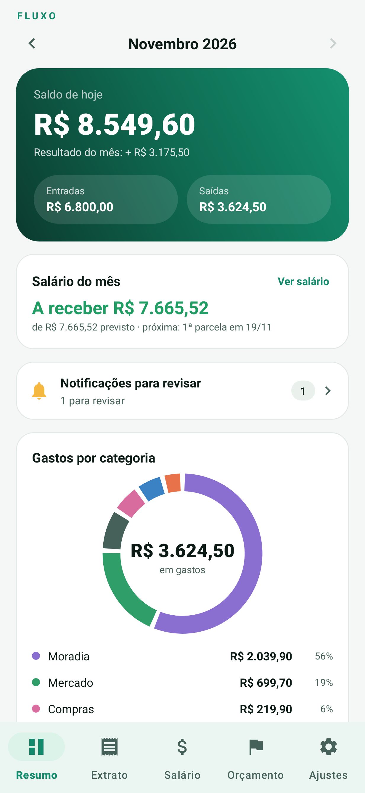
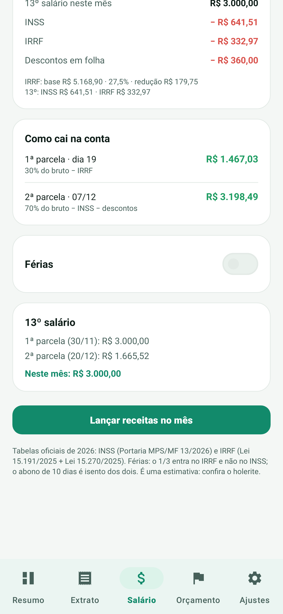
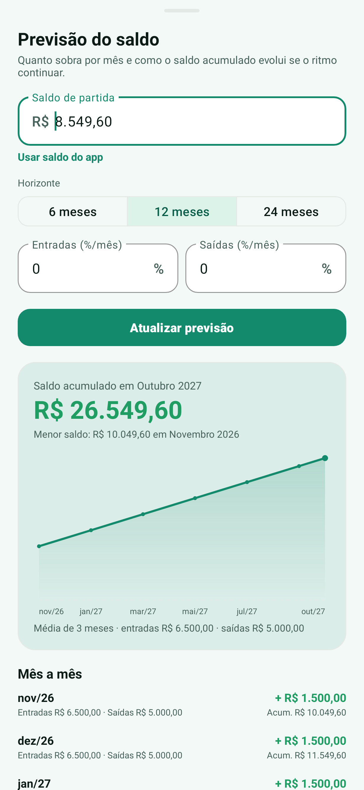

# Fluxo

[](https://github.com/VLDias/fluxo-financas/actions/workflows/android.yml)

Aplicativo Android de finanças pessoais, **offline**, sem anúncios e sem conta em nuvem. Registra gastos e receitas, importa notificações de bancos, controla orçamentos, calcula o salário CLT (INSS/IRRF, férias e 13º) e projeta o saldo acumulado.



## Recursos

- **Visão geral** separando o **saldo de hoje** (o que já entrou/saiu) do **resultado do mês** e do **salário a receber**.
- **Importação por notificações** de Nubank, Itaú, Bradesco, Santander, Caixa, Inter, C6, PicPay, Mercado Pago, Neon, Banco do Brasil, BTG, Sicoob, Sicredi, Original, Wise, Revolut, PagBank e Google Wallet.
  - Extrai valor, direção (compra/Pix enviado x recebido/estorno), estabelecimento, cartão e categoria.
  - Deduplica, ignora promoções e códigos, e manda o que é ambíguo para uma **fila de revisão** em vez de chutar.
- **Lançamentos manuais** com categorias, conta, data, observação e busca.
- **Orçamento mensal** por categoria, com alerta em 80% e 100%.
- **Salário CLT 2026**:
  - INSS progressivo e IRRF com a redução da Lei 15.270/2025.
  - Divisão configurável (ex.: 30% no dia 19 e 70% no 5º dia útil do mês seguinte).
  - Descontos fixos ou percentuais, inclusive no 13º.
  - Férias com 1/3 e abono de 10 dias.
  - 13º em duas parcelas, com mês e dia configuráveis.
  - **Vigência por mês**: mudar o salário em dezembro não reescreve novembro.
- **Previsão de saldo** com média dos últimos 3 meses, crescimento mensal de entradas/saídas, horizontes de 6, 12 ou 24 meses e gráfico do acumulado.
- Tema claro e escuro, Material 3.

| Salário | Previsão |
| --- | --- |
|  |  |

## Privacidade

- O APK **não pede permissão de INTERNET**. Os dados ficam num banco SQLite local no aparelho.
- O acesso às notificações é opcional e usado apenas para criar lançamentos no próprio app.
- Não há login, telemetria, anúncios ou envio para servidor.

## Instalação

1. Baixe o APK na aba [Releases](https://github.com/VLDias/fluxo-financas/releases).
2. Requer **Android 8.0+** (API 26). O APK é *sideload*, não está na Play Store.
3. O Play Protect pode bloquear apps instalados fora da loja. Se isso acontecer, desative temporariamente a verificação (Play Store → Play Protect → engrenagem) ou instale via `adb install -r`.
4. Abra **Ajustes → Acesso às notificações** e autorize o Fluxo. No Android 13+, se a opção estiver cinza: **Apps → Fluxo → ⋮ → Permitir configurações restritas**.
5. No HyperOS/MIUI, deixe a economia de bateria em **Sem restrições** e ative a inicialização automática para o serviço continuar lendo notificações.

## Desenvolvimento

Requisitos: JDK 17 ou 21, Android SDK 35 e Gradle (o wrapper já está no repositório).

```bash
git clone https://github.com/VLDias/fluxo-financas.git
cd fluxo-financas
echo "sdk.dir=/caminho/para/Android/Sdk" > local.properties
./gradlew assembleDebug
./gradlew testDebugUnitTest
```

Para gerar as capturas de tela usadas na documentação:

```bash
FLUXO_SCREENSHOTS=1 FLUXO_SCREENSHOTS_DIR=screenshots ./gradlew testDebugUnitTest
```

### Assinatura do release

O repositório **não** contém keystore. Para gerar um APK de release assinado, crie um keystore local e um `keystore.properties` (ambos ignorados pelo Git):

```properties
storeFile=fluxo-release.jks
storePassword=...
keyAlias=fluxo
keyPassword=...
```

```bash
./gradlew assembleRelease
```

## Cálculos de folha

As tabelas padrão são as oficiais de **2026**:

- INSS: [tabela de contribuição mensal](https://www.gov.br/inss/pt-br/direitos-e-deveres/inscricao-e-contribuicao/tabela-de-contribuicao-mensal) (Portaria Interministerial MPS/MF nº 13/2026).
- IRRF: [tabela de tributação de 2026](https://www.gov.br/receitafederal/pt-br/assuntos/meu-imposto-de-renda/tabelas/2026) (Lei 15.191/2025 + redução da Lei 15.270/2025).

Premissas de férias e 13º:

- Férias: salário/30 × dias + 1/3. O 1/3 entra na base do IRRF e **não** na do INSS; o abono de 10 dias é isento dos dois.
- 13º: INSS e IRRF calculados separadamente sobre o 13º, nunca somados ao salário de dezembro.
- 13º proporcional usa os meses trabalhados informados.
- Dia útil considera fins de semana, feriados nacionais e Sexta-feira Santa; não inclui Carnaval/Corpus Christi (facultativos).

> Os valores são uma **estimativa** para planejamento. Confira sempre o holerite oficial. O app não é aconselhamento financeiro nem substitui a folha da empresa.

## Limitações

- O texto das notificações varia por banco e versão do app. Formatos não reconhecidos viram pendências para revisão.
- A previsão é estatística: não antecipa férias, 13º ou aumentos que ainda não foram lançados.
- Apenas Android; não há versão web/iOS.

## Licença

Copyright (C) 2026 Vitor Luis Dias.

Distribuído sob a **GNU General Public License v3.0** — veja [LICENSE](LICENSE). É software livre: você pode usar, estudar, modificar e redistribuir, desde que as versões derivadas mantenham a mesma licença.

## Créditos

- Ícones baseados em [Material Symbols](https://fonts.google.com/icons) (Apache License 2.0).
- [AndroidX](https://developer.android.com/jetpack/androidx) e [Material Components for Android](https://github.com/material-components/material-components-android) (Apache License 2.0).
